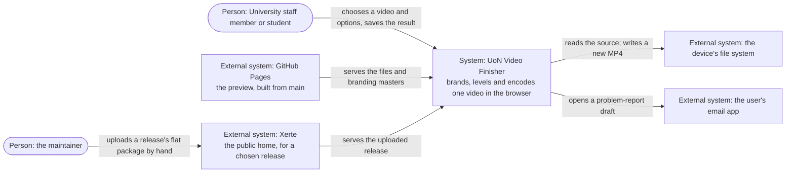
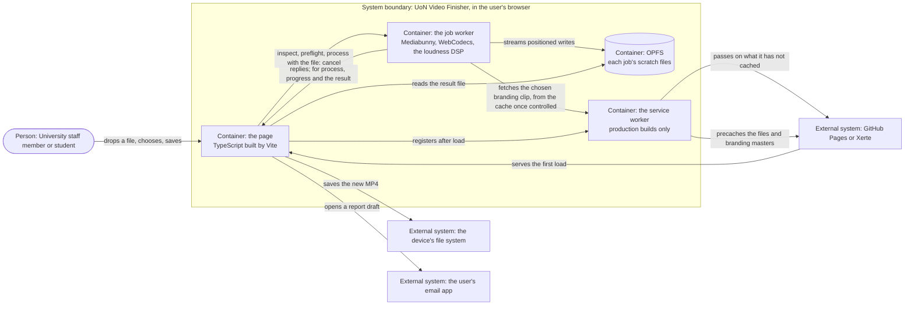

# Architecture — UoN Video Finisher

Updated: 2026-11-27

<!-- pm-next architecture record, specification 3.26 — keep this line -->

<!-- The optional architecture record (specification 3.26), from the
     pack's template, routed by rules.md's By-task row. A change that
     adds, removes or renames a person, an external system or a
     container, moves the boundary or changes how two of them talk
     updates this file and its Updated line in the same change. The
     line above marks this file as the record. The engineering rules
     are project/engineering.md. -->

## System context

Static files, no server of our own. Processing uploads no media and
no filename; the path of a fetched branding master names its
resolution tier (VH-249.3).

### Text alternative

- Staff and students choose one video and a few options in the page,
  Chrome being the supported browser, and the Finisher brands, levels
  and encodes it, writing a new MP4 to the device; the source is never
  modified.
- A problem report is a draft in the user's email app, which may hold
  the video's duration, dimensions, frame rate and codecs, sent only
  by the user; Copy puts it on the clipboard instead.
- GitHub Pages serves the preview built from `main`. Xerte serves the
  flat release package the maintainer uploads; 0.3.1's upload is
  pending (VH-14).

## Containers

### Text alternative

- The user drops or chooses a file, sets the options and saves.
- The page sends the job worker the file with `inspect`, `preflight`
  or `process`, or a `cancel`; the worker replies, and for
  `process` sends progress and the result as an OPFS-backed file
  (`src/workers/protocol.ts`).
- The worker demuxes and muxes with Mediabunny, codes with WebCodecs,
  levels the audio, fetches the chosen branding clip, from the host on
  a first load and through the service worker after, and streams its
  output into OPFS, never holding the whole file.
- A finished job keeps its OPFS directory for the page to read; a
  cancel disposes of it; at start the worker retries any directory no
  tab holds, and a failed removal waits for a later start.
- The page saves by the file picker, streaming, or as a download it
  cannot see finish, the result kept until the user discards it, which
  can come before the download has read it.
- The page opens a report draft in the user's email app.
- The host serves the first load; the page then registers the service
  worker, which precaches the files and masters: the network first for
  the page, its cache first for other in-scope assets, the chosen
  branding clip among them, so a controlled page
  works offline.
