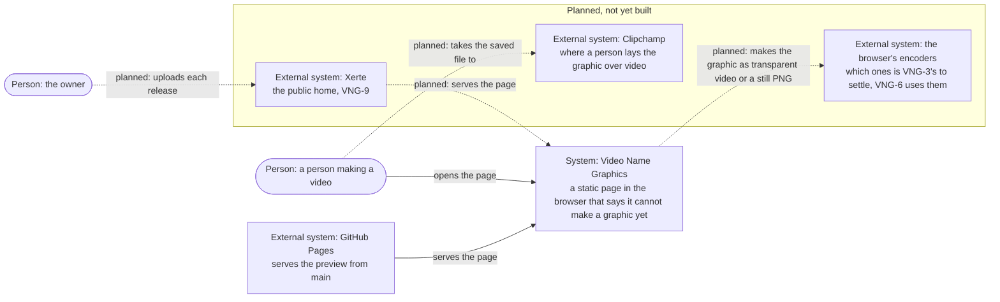

# Architecture — Video Name Graphics

Updated: 2026-11-27

<!-- pm-next architecture record, specification 3.26 — keep this line -->

<!-- pm-next v3.1's optional architecture record (specification 3.26),
     adopted by VNG-14 on the owner's "retrofit everything in full",
     though the tool runs one container. Never in the base read:
     rules.md's By-task row routes to it, "a container, external
     system, boundary or interface change | project/architecture.md |
     400 | none". A change that adds, removes or renames an external
     system or a container, moves the system's boundary or changes how
     two of them talk updates this file in the same change, and its
     Updated line; so does a person added, removed or renamed, which
     the row does not name. Directories belong in structure.md, not
     here. The checker reads only the envelope: the title, one Updated
     line, ## System context, its one mermaid fence and its ### Text
     alternative. The Containers level is left out: one container, the
     page in the browser. -->

## System context

What the seed runs today is drawn in solid lines: a static page, served
by GitHub Pages as the unadvertised preview, that says it cannot make a
graphic yet. What later items bring is drawn apart, in dashed lines and
marked planned.

### Text alternative

- A person making a video, staff or student, or anyone through the
  neutral build, opens Video Name Graphics, a static page that runs
  only in their browser and today says it cannot make a graphic yet.
- GitHub Pages serves that page as the unadvertised preview, built from
  `main` by the repository's one workflow.
- Planned, not yet built: the page asks the browser's own encoders to
  make the graphic as transparent video or a still PNG; which encoders,
  WebCodecs a candidate for the video, is VNG-3's to settle, and VNG-6
  uses them; nothing typed leaves the device.
- Planned: the owner uploads each release to Xerte, the public home,
  which then serves the page (VNG-9).
- Planned: the person takes the saved file to Clipchamp and
  lays it over their video; what Clipchamp accepts is checked by a
  person.
