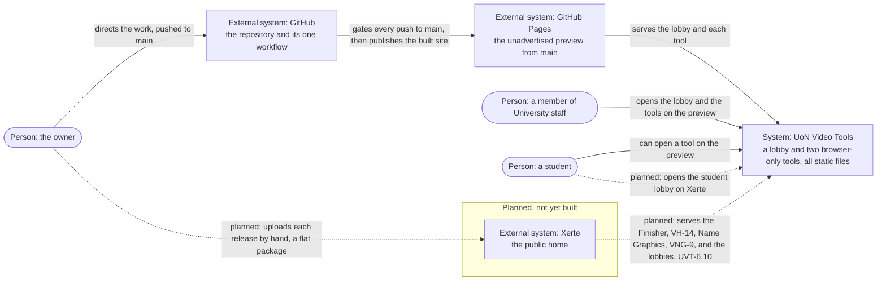
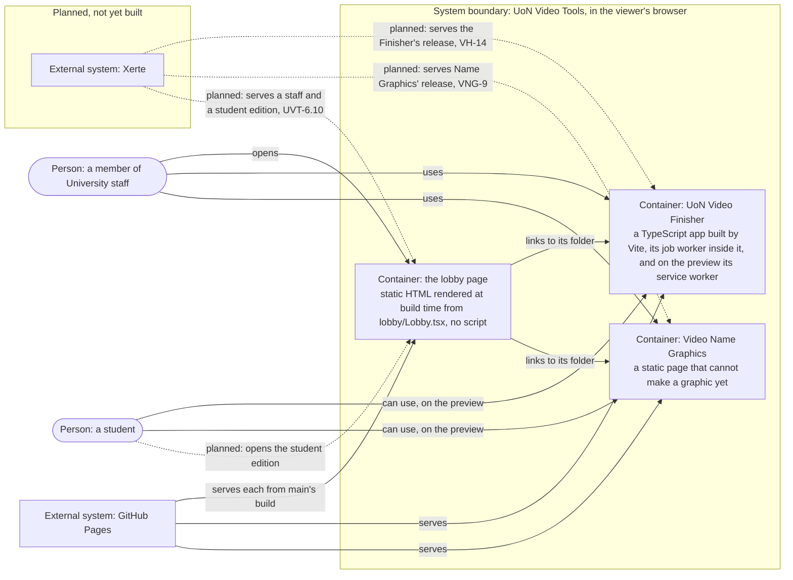

# Architecture — UoN Video Tools

Updated: 2026-11-27

<!-- pm-next architecture record, specification 3.26 — keep this line -->

<!-- pm-next v3.1's optional architecture record (specification 3.26),
     adopted by UVT-8 on the owner's "retrofit everything in full": the
     whole system as the root sees it, the lobby and the two tools.
     Never in the base read: rules.md's By-task row routes to it, "a
     container, external system, boundary or interface change |
     project/architecture.md | 400 | none". A change that adds, removes
     or renames an external system or a container, moves the system's
     boundary or changes how two of them talk updates this file in the
     same change, and its Updated line; so does a person added, removed
     or renamed, which the row does not name. Each tool's own record
     draws its inside: finisher/project/architecture.md and
     name-graphics/project/architecture.md. Directories belong in
     structure.md, not here. The checker reads only the envelope: the
     title, one Updated line, ## System context and ## Containers, each
     with one mermaid fence and its ### Text alternative. -->

## System context

What runs today is drawn in solid lines; what later items bring is
drawn apart, in dashed lines and marked planned. Each tool's own
outside systems, such as the device's files, are in its own record.

### Text alternative

- Staff open the lobby and both tools on the preview, the unadvertised
  site on GitHub Pages; each tool runs in their own browser. The
  preview is public, so a student can open a tool there too.
- The owner directs the work in the repository on GitHub; every push to
  `main` runs the one workflow, which gates every tool and the root,
  then publishes the built site to GitHub Pages.
- GitHub Pages serves the lobby at the top and each tool in its folder.
- Xerte is the planned public home. The owner uploads each release
  there by hand as a flat package. The Finisher's 0.3.1 is cut and waits on
  that upload (VH-14); Name Graphics' first release is VNG-9; a staff
  and a student lobby there link to the tools, and students start from
  the student lobby (UVT-6.10).

## Containers

### Text alternative

- The lobby page is static HTML that the build renders from
  `lobby/Lobby.tsx`; it ships no script and no service worker, and
  links to each tool's folder on the same site.
- UoN Video Finisher is a TypeScript app built by Vite that runs in
  the viewer's browser, its job worker inside it; the preview's build
  adds its service worker, which the 0.3.1 release cut for Xerte
  predates (VH-161). Its own record draws them.
- Video Name Graphics is a static page that says it cannot make a
  graphic yet; its own backlog builds the tool, and its own record
  draws it.
- Staff open the lobby and use both tools, and a student can use
  either on the preview; GitHub Pages serves all three from `main`'s
  build.
- Planned: Xerte serves the Finisher's release (VH-14), Name Graphics'
  (VNG-9) and a staff and a student edition of the lobby (UVT-6.10);
  students open the student edition.
- `shared/` is source both tools build in, not a container: it runs
  only inside each tool.
